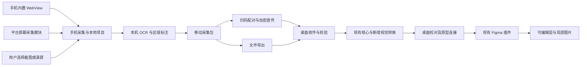

# Web-AppToPrototype 移动端产品与技术计划

日期：2026-10-20（Australia/Sydney）。本文件保留完整产品规划；业务alpha已经实施，实际范围/证据以PROGRESS第7节和ROADMAP执行摘要为准，设备验收仍待用户。下文未更新的候选范围/工期不代表当前程序已支持。

## 0. 当前工程与执行入口

实际项目为`E:\WebToPrototype\MobileApp\webapptoprototype`，独立Git仓库origin为`https://github.com/NarIyirm/Web-AppToPrototype.git`；当前Expo57.0.30、RN0.86.3、React19.2.3、TypeScript6.0.3，用户要求由初始化SDK58降为57。复用现有工程，禁止再建apps/mobile。

先读[HANDOFF](HANDOFF.md)和[PROGRESS](PROGRESS.md)，实施以[ROADMAP](ROADMAP.md)为准；协议见[PROTOCOL-DRAFT](PROTOCOL-DRAFT.md)，页面见[DESIGN](DESIGN.md)，验收见[ACCEPTANCE](ACCEPTANCE.md)。原3处模板类型错误/缺lint已修复，后续不重复BASE；视频/长页/多选/完整重建等未完范围继续按子项实施。

用户app.json已有EAS关联等修改，必须保留。版本以package-lock与实装为准，不在计划阶段升级依赖。此文档包是移动仓库当前方案；父项目docs/25保留首轮讨论历史并指向本目录。

2026-10-20补充：用户确认更新Expo Go后启动恢复，并要求优先扫码局域网传输与简约可操作UI。已新增基于SDK自带加密的LAN路径，Expo Go不需自定义传输模块即可扫码发送；独立包仍使用固定证书TLS。当前主入口为“添加画面 / 我的项目 / 发送到电脑”。下文早期“Expo Go仅界面/TLS唯一传输”描述由本段及PROTOCOL-DRAFT的v2规范覆盖。用户负责最后手机/Figma反馈，不扩大手工验收。

## 1. 已确认需求与实施原则

用户确认桌面端整体使用没有问题，现要求详细规划移动端：采用Expo，同时支持Android/iOS，输入包含网页和其他原生App界面，结果可传给电脑并导入Figma。

最新优先级：**Android、iOS同等优先，同一产品路线、同一阶段交付与验收，不再沿用历史“Android优先”安排。** Expo共享产品界面、项目、传输任务和协议代码；操作系统级跨App采集由各自原生适配器实现。平台能力不同的功能必须明确标注，不以两端按钮相同代替能力成立。

已知设备：iPhone 16 Pro；iOS版本尚未提供。Android真机型号/系统、Mac上的Xcode和iOS签名条件尚未核实。缺Android设备不妨碍公共模块和iOS探针，但Android原生功能不能用模拟器或iPhone结果宣布验收通过。

第一版建议定位为“手机采集，电脑整理和转换，Figma编辑演示”。先做本地链路和小范围测试，不引入云账号、常驻服务器、AI付费接口或后台自动遍历。公开上架是独立交付门槛，不能用内部安装成功替代。

## 2. 产品能力分级

| 输入 | 可取得的主要信息 | 第一版输出目标 | 明确边界 |
|---|---|---|---|
| 应用内打开的网页/H5，两平台 | DOM、可读样式、几何、图片及用户保存的状态 | 支持范围内的文字、形状、图片等可编辑图层；手工原型连线 | WebView兼容性单独验证；跨域iframe、闭合ShadowRoot、Canvas等不承诺完整结构 |
| Android原生App，基础模式 | 用户授权的屏幕画面或用户导入截图 | OCR文字、可靠基础形状、图片区域和热点组成的混合原型 | 屏幕像素不包含原始设计参数、完整资源与业务逻辑 |
| Android原生App，可选增强 | 在授权、目标App暴露信息且发布条件允许时取得部分无障碍节点 | 辅助文字、边界、语义命名和候选热点；结合画面重建 | 不是实际View树；不保证字体、样式、Canvas/游戏/Flutter等自绘结构；不是基本模式依赖 |
| iOS原生App，基础模式 | 用户导入截图/录屏中的画面 | 同样的OCR、基础形状、局部图片和热点 | 不把其他App的UIKit/SwiftUI控件树读取作为公开方案 |
| iOS原生App，系统采集增强 | 经版本与签名验证后，通过系统授权取得屏幕帧 | 减少手工截图/导入；重建质量仍属于视觉推断 | 屏幕采集API版本和后台执行条件必须先做真机探针，不承诺任意App均能采集 |

网页以结构重建为主，原生App以视觉重建为主。后者可以产出可修改文字与部分形状，但不能承诺与网页相同的可编辑覆盖率。完整截图只能计为图片，不能计为完整可编辑转换。

对受系统或目标App保护的内容，显示不可采集/局部缺失；黑帧只作为异常候选，还要区分真实黑色界面，不能仅凭全黑判定原因。不规划绕过受保护窗口、密码遮蔽或DRM。

## 3. 用户流程

### 3.1 网页采集

在手机应用输入地址→正常浏览/手动登录→选择视口、元素或矩形→确认排除/裁切→保存状态→继续浏览并保存下一状态→预览并发送电脑。

首批交付视口、元素、矩形与多状态；有界长页/多选/排除在同一网页阶段后半批加入，手势需要各自真机验证。选择模式与正常浏览分开，避免长按选区触发网页菜单、滚动或误点击。提供“扩大到父级”“撤销选择”和数值裁切替代精细手势。iOS系统缩放、键盘和安全区不应破坏坐标。

### 3.2 原生App采集

两端共用稳定入口：选择用户截图/录屏→挑选状态画面→裁切/遮挡敏感区域→OCR与区域识别→校对文字和降级区域→发送电脑。首次只请求所需文件，音频不进入采集任务。

Android增强：在本应用启动屏幕共享授权→按系统提供的范围选择→切换目标App并正常操作→保存需要的状态→停止采集→回应用整理。优先采用系统通知等操作入口；跨App悬浮按钮不是首版前提，不为它默认增加悬浮窗权限。

iOS增强：使用适配当前系统版本的系统采集入口；先验证“开始→切换App→取得帧→停止→回应用选择画面”。不能假设iOS允许像Android那样放一个跨App悬浮采集按钮。电脑端远程触发抓帧属于增强项，必须在后台通信实际可用后再承诺。

原生App长内容先由用户分段保存多个状态，不做任意App自动滚动。可选拼接必须确认重叠与顺序；无法判断连续性的片段保持独立画面，避免把不同状态拼为假长页。

### 3.3 手机到电脑与Figma

电脑“连接手机”→显示短期二维码→手机扫码→电脑确认设备→手机发送已选任务→电脑收件箱显示预览和校验结果→用户检查重建/连接热点→使用现有Figma插件导入→回传导入结果。

明确显示“手机已保存”“电脑已接收”“转换已完成”“Figma已导入”四个独立状态。传输成功不等于原型导入成功。Figma插件关闭时保留电脑收件，不丢手机原始任务。

## 4. 架构与职责



| 部分 | 负责 | 技术建议 |
|---|---|---|
| 移动界面 | 来源选择、浏览、触控选区、项目、扫码、任务与预览 | Expo、React Native、TypeScript、原生导航 |
| 网页适配 | 页面读取、页面实例/选择生命周期、资源固化 | react-native-webview；从现有代码拆出平台无关逻辑，重写宿主接口 |
| Android原生采集 | MediaProjection生命周期、前台服务、画面方向、停止回收 | Kotlin本地Expo Module；可选无障碍模块独立开关 |
| iOS原生采集 | 系统录屏/屏幕采集、必要扩展、系统生命周期 | Swift本地Expo Module；按SDK可用性选择实现 |
| OCR | 中英文识别、位置、置信度、低置信度提示 | Android ML Kit、iOS Vision；先核实语言和离线模型 |
| 手机资源存储 | 原始画面、缩略图、任务清单、重启恢复 | 应用私有文件目录；JS只传路径与小元信息，避免整帧base64反复过桥 |
| 桌面接收 | 设备配对、加密收件、任务确认、恢复和导入前校验 | Electron新增独立接收服务；不改现有Figma回环监听范围 |
| 转换/协议 | 归一化、区域融合、降级、资源摘要、原型状态 | 共享纯TS模块；桌面执行首版重建，手机离线完整转换不作首批依赖 |

采用Development Build和本地原生模块，Expo Go仅可作不含自定义模块的界面试验。原生依赖在本移动项目根package.json显式声明，锁定单一兼容版本；通过Config Plugin维护Manifest、Info.plist、扩展和签名配置，不能把手改生成目录当作可重复构建方案。原生能力变更需重新构建安装包，不能仅依赖JS热更新。

首版建议目录（现有与拟建分开标记）：

```text
webapptoprototype/                    已存在：独立移动仓库根
  src/app/                           已存在：Expo Router模板页面
  src/components/                    已存在：模板组件，按阶段调整
  docs/                              本轮建立：计划、进度与交接
  src/features/capture/              拟建：网页与原生画面采集
  src/features/projects/             拟建：状态、裁切和校对
  src/features/transfer/             拟建：配对和任务
  src/core/                          拟建：几何、状态、校验
  modules/screen-capture/             拟建：平台屏幕采集适配
  modules/text-recognition/           拟建：本机OCR适配
  contracts/                         拟建：移动原始契约与夹具
  tests/                             拟建：核心逻辑和故障用例
  fixtures/                          拟建：本地测试素材
  verification/                      拟建：开发/真机证据
```

移动仓库独立于桌面，不读取仓库外源码作为运行依赖；桌面收件/转换通过版本化契约产物集成，详见PROTOCOL-DRAFT。上图为规划布局，当前真实目录见PROGRESS/HANDOFF。

## 5. 平台原生能力的验证路线

### 5.1 Android

基础路线使用MediaProjection。Android14及以上的相关前台服务类型与权限、每次会话授权、投影停止回调、单次会话资源使用都按目标SDK验证。授权撤销、锁屏、旋转或捕获尺寸变化时结束/重建当前任务，不复用失效令牌冒充继续采集。仅在用户主动采集期间保持系统可见的采集状态。

可选AccessibilityService只在基础捕获及政策可行性过关后加入；采集可获取的文字、边界、描述和状态，不请求执行点击/自动操作来获取更多页面。截图与节点不是天然原子快照，应记录时间/窗口标识、前后结构指纹；变化时丢弃融合结果或退回仅画面，不能把不同时刻的节点与画面强行配准。

无障碍节点的存在不能证明其样式真实，实际View、Compose语义、自绘、WebView及Flutter表现分别测试。Google Play声明、显著告知和用户同意属于公开发布门槛，不把本工具伪装为面向残障用户的辅助工具；基础版应在未启用该权限时仍可用。

### 5.2 iOS

先交付截图/录屏导入，再验证系统采集增强。当前核对到Apple官方ScreenCaptureKit的iOS样例要求iOS27或以上，框架文档说明其接替ReplayKit的屏幕流/镜像用途。**这不表示现有iPhone16Pro已经运行对应系统，也不表示所有系统版本都可直接使用。** 不能只看硬件型号判断API可用性。

MOB-00需记录实际iOS、Xcode/SDK、符号availability、签名与安装路径：满足条件时试验ScreenCaptureKit及系统选择器；需要兼容更早系统时，另验证ReplayKit Broadcast Upload Extension路线的实际可用性、扩展通信和发布支持。若采用扩展，处理独立进程、共享容器、有限内存和主应用挂起；OCR尽可能在画面选择后由主应用执行，不在扩展内装载整套React Native或重建所有图层。

如果系统采集探针失败，截图/用户录屏导入可以继续发布，但“实时跨App采集”必须保持未完成并列出具体失败条件。不能用截图导入通过给系统采集打勾，也不把公开API不可用当作可以调用私有接口的理由。

不将其他App的可访问性/控件树、原图文件、登录状态或业务逻辑读取作为iOS目标；原生App输出依据可见像素与用户确认信息生成，无法获得的信息不编造。

## 6. 网页与原生画面的转换策略

### 6.1 网页

复用既有场景协议概念、几何算法、样式归一化和Figma节点创建。Electron宿主调用、隔离执行、资源请求、图片解码以及session相关代码需适配WebView/原生宿主，不能直接复制执行。尤其验证WebKit与Android WebView的文本换行、滚动、fixed/sticky、SVG、iframe和图片鉴权差异。

页面消息桥只接受与当前pageEpoch/采集任务匹配的受限采集结果，并做结构/长度校验；目标网页不能调用配对、磁盘、摄像头或原生采集模块。跨域/认证资源取不到时保留告警或局部图片，不关闭浏览器隔离、不转交Cookie给电脑。

### 6.2 原生App

逐步处理：画面方向和安全区校正→用户裁切/遮挡→本机OCR→可用节点辅助→区域融合与去重→可靠形状/文字重建→复杂区域保留局部图片→人工修正→状态/热点连接。

文字识别只能推断文字内容和位置，字号、字体、字距、颜色和排版可能为近似。无可靠证据的图标不能宣称恢复原始矢量；先用独立图片裁切。只对高可靠的纯色矩形、统一圆角、简单边框做首批形状重建，透明、模糊、复杂纹理优先保留图片。

**必须解决重复文字问题：** 不能把完整截图放底部再叠OCR文字后宣称文字可编辑。修改新文字后，底图旧字仍会露出。仅在背景可可靠重建/原文字像素确实被移除的区域输出替换文字；无法清理的区域保留图片，并允许用户选择重做该区域。未经验证的图片修补不自动修改真实内容。

每个内容节点保留来源类别（DOM/无障碍/OCR/形状推断/原图裁切/用户修正）、已知置信度、源区域与告警。来源为OCR或视觉推断时，即使落到Figma原生TEXT/SHAPE也应标为approximated，不因它可编辑就标为测量所得native。未知置信度不能填伪造百分比。

原图作为单独网页/画面对照，不默认混入导出设计根；对照可含整图，但不计可编辑输出。统计同时列可编辑文字覆盖、保留图片区域占比、缺失区域和人工修改数，不能靠大量透明辅助节点提高保真得分。

## 7. 坐标、原始包与兼容性

现有CapturePackage的source.kind固定为web，schemaVersion固定1.0.0。**现在不能把原生App截图随便包装为web再交给旧插件。** 本计划拟分两层：

1. 移动原始采集包MobileCaptureBundle（拟0.1）：手机到电脑的素材/快照格式，包含类型、画面、可选DOM或节点/OCR观察、裁切、变换、摘要和任务标识；不交给Figma插件直接执行。
2. 最终CapturePackage：桌面转换完成后产生。建议为含native/screenshot来源和provenance的扩展拟定2.0，MOB-02兼容评审后冻结具体版本；新桌面/插件双读既有1.0与新格式。旧插件明确拒绝新格式并给升级提示，旧桌面包继续可用。

移动原始包使用独立格式标识和白名单ZIP条目，不能与现有capture.json/assets的最终ZIP混淆；源码、生成校验器、资源和兼容用例同步更新后才建立命令。扩展到sourceOverride时同步覆盖多来源项目，保留每个状态的实际来源，不能错误共用网页URL。

至少保存：captureId、attemptId、captureEpoch、平台/系统/适配器版本、实际来源（未知App标识则留空）、时间、物理图片尺寸、逻辑画布尺寸、方向、捕获内容矩形、裁切/遮挡区域、坐标变换、原始/处理后资源摘要。视频挑帧同时记录视频内时间点，不保留不必要音频。

不得直接假设截图像素除DPR就是网页CSS坐标。屏幕共享可能被缩放、限定应用窗口、加黑边或受方向影响；使用明确的变换和校准点。捕获中方向/窗口尺寸变化使当前选区失效并保留已完成状态。

遮挡操作应在发送前作用于画面及派生OCR/节点/缩略图，默认共享包不附带未遮挡原图，不能只在预览上盖黑块而把原始敏感内容继续发出。源URL默认脱敏，包不含Cookie、密码、配对秘密或设备系统账号。

## 8. 手机到电脑传输与恢复

主方案为局域网扫码加密直传，文件导出为稳定回退，云中转另行规划。手机和电脑需要实际网络互通；同一Wi-Fi名称不能证明设备互通。首版允许手动选择电脑接收网卡并重新生成二维码，不依赖广播发现；Bonjour/mDNS自动发现可后加。

当前43821仅服务电脑本机Figma桥接，继续保持127.0.0.1监听和现有鉴权。手机接收采用独立端口、独立令牌、独立路径与任务存储，仅用户打开“接收手机”时启用。手机认证不能调用Figma配对、浏览器操作或任意磁盘读写。

加密建议采用HTTPS及二维码绑定的服务公钥指纹，通过本地原生网络模块做对应会话的证书固定；先做Android/iOS与Windows/macOS握手探针。不能假设普通fetch会自动接受局域网自签名证书，也不能全局关闭TLS校验。具体实现使用维护中的系统网络/加密库，MOB-00通过后锁定版本；二维码来自用户正在使用的桌面窗口，扫码后双方显示匹配信息。

二维码内容仅含协议标识、受限接收端点、配对ID、到期时间、公钥指纹和一次性秘密，不含原型、Cookie或长期令牌；不作为普通网页URL自动打开，不把秘密写入请求日志。设备确认后换取会话令牌，限制到上传本人任务。处理二维码畸形、过期、重放、错误证书、重定向及非接收端点。

建议首批参数（需压测后冻结）：二维码有效2分钟、每分钟最多5次失败尝试、会话空闲30分钟失效；单设备一个活动上传，最多两个待处理任务，旧任务不会因新上传被覆盖。

传输按256KiB二进制块开始，逐块校验摘要/序号与完整ZIP摘要；大小上限须在申请任务时即检查，不能收满后才拒绝。上传临时文件位于受控收件目录，完整校验并原子提交后才显示“电脑已接收”。

幂等键使用transferId+不可变内容摘要；内容不同不能复用原任务ID。断网保存已确认块位图，同电脑/同文件/同有效授权可恢复，重连核实整包身份；桌面重启或授权失效后重新配对并重新授权旧任务，不能接受旧令牌。传输状态与Figma importId分离，回执丢失不能自动生成第二套原型。

文件回退分清两类：未转换原始ZIP由电脑打开；完成转换后的CapturePackage ZIP可由兼容Figma插件导入。首版手机不要求独立完成桌面转换，所以未连接电脑时也能保存采集任务，但不宣称可离线直接导出完整可编辑Figma包。

## 9. 页面、存储和预算

手机主界面建议保持简约：采集、项目、连接电脑三个入口。采集页选择网页/原生画面来源；项目详情管理状态、裁切/遮挡和发送；连接页显示电脑身份、网络和传输任务。字体/资源/识别详情放诊断或结果区域，主流程不用要求用户理解DOM、OCR API或原生进程。

电脑端只新增可折叠“手机收件箱”和必要的文字/区域校对，沿用现有状态/热点工具、简约布局和Figma发送。不得因移动扩展重做已接受的桌面工作台或原图层行为。

建议初始预算：单原始ZIP及展开各≤64MiB、单图≤10MiB且长边≤4096、节点≤5000、项目状态≤20、首批单次发送≤5个状态；超过限制要求拆批/降采样并明确原因。最终CapturePackage继续服从现有50MiB正文、30MiB资源等预算，不能因手机输入绕过。原始视频导入上限/时长由MOB-00实测后冻结，避免先选大文件再无界解码。

仅按用户选择提取帧，预览单独降采样；原生层串行处理或保持有界队列，不把视频全解码为JS数组。不以手机持续录制全部操作作为普通保存方式。系统采集服务/扩展的内存和后台预算独立测量，不能照搬主应用预算。

捕获、任务和项目采用不可变修订、原子清单及资源引用计数；失败、取消和权限拒绝保留上次成功捕获。数据清理有预览和确认，不能清除目标App资料。手机原始任务在电脑确认接收前默认保留；确认接收后也不擅自自动删除。

## 10. 阶段、依赖和退出门槛

各阶段同时列出Android/iOS要求；可共享部分先推进，平台差异单独验证。下列任务全部为planned，只有证据齐全的子项可改为development_complete或user_verified。

| 阶段 | 任务ID | 工作内容 | 验收与失败处理 | 估算工程日 |
|---|---|---|---|---|
| 可行性 | MOB-00a–e | 核实Expo/RN/Node/SDK兼容；两端WebView/本机OCR/系统采集；局域网TLS固定；iOS签名安装与Android真机 | 两端真实画面或明确API失败；旧App不受影响；系统采集失败保留独立阻塞，不影响截图导入 | 4–7 |
| 基础与协议 | MOB-01、02 | Expo工程、应用私有项目、原始包校验、最终协议兼容设计、桌面收件探针 | 两端选择截图→保存→重启重开；合法/畸形包校验；1.0旧包仍可导入 | 5–8 |
| 网页采集 | MOB-03a–c | 两端WebView浏览、视口/元素/矩形、多状态；随后有界长页、多选/排除和资源 | 同一H5基准两平台可编辑文字/形状/图片；坐标与恢复达标；各自兼容清单 | 7–10 |
| 原生视觉转换 | MOB-04a–c | 两端截图/录屏挑帧、本机OCR、区域裁切、基础形状、桌面文字校对与来源报告 | 简单原生基准的标题/按钮可改且无旧字残留；复杂区诚实保留图片，OCR不是整页可编辑证明 | 6–10 |
| 系统采集增强 | MOB-05A、05I | 同阶段推进Android MediaProjection与iOS适用系统API；停止/方向/后台/权限恢复 | 在各自真机切换测试App取得状态；禁止区域/撤销/中断均有可解释结果；失败保留待办 | 8–15 |
| 直传与原型 | MOB-06、07 | 两端扫码、确认、加密分块与恢复；电脑收件校对，多状态/手工热点和回执 | 两种手机到两种电脑四组合；断线重试不重复导入；列表→详情→弹窗→返回可播放 | 3–5 |
| 分发与回归 | MOB-08 | 两平台安装包、设备矩阵、OOM/后台/网络故障、隐私/清理、操作说明 | 独立安装、权限拒绝可恢复、旧桌面包/项目回归通过，用户最终Figma验收 | 5–8 |

MOB-06的基础收件/握手必须在MOB-00/01先打通，表中后期才完成恢复与交互体验，不能等做完手机全部界面才验证传输。MOB-05也必须在MOB-00先验证最薄可行链路；正式生命周期/错误处理在05完成。

可选MOB-09：Android无障碍增强、两端系统分享入口、设备自动发现、可靠长截图拼接；不让这些阻挡基础版。可选MOB-10：自有App集成开发SDK，从开发者主动提供的布局/样式生成更准确图层，不将该能力推广为任意第三方App支持。

单工程师顺序完成上述核心阶段粗估38–63工程日，另预留10–20工程日处理原生API、OEM、识别质量和签名问题；不含商店审核等待、设备采购和外部账号等待。可共享代码减少重复工作，但网页双引擎适配和原生跨App采集仍占主要成本。它是范围估算，MOB-00后按实测重估，不是交付日期承诺。

建议分三次可体验交付：D1两平台截图/网页最薄链路和电脑接收；D2完整网页及原生视觉混合原型；D3两平台系统采集增强与分发。每次都报告两端实际通过/未通过，不能把一端发布冒充通用功能完成。

## 11. 验收矩阵与建议目标

以下为拟定门槛，MOB-00用固定基准校准后冻结，不拿未知第三方App保证100%或固定全局相似度。

| 编号 | 真实验收 | 目标/证据 |
|---|---|---|
| MW01 | 两端网页视口、元素、矩形及滚动后选择 | 固定静态基准主要边界误差≤2个逻辑像素；记录缩放、DPR与实际截图，不将抗锯齿误差混为几何误差 |
| MW02 | 两端网页原生文字/图片/样式、资源失效 | 可修改标题/按钮/图片；缺图/字体有定位告警，复杂WebView边界显式记录 |
| MN01 | 两端截图/录屏挑帧导入 | 尺寸/方向/裁切一致；取消/畸形/过大文件不损坏旧项目 |
| MN02 | 中文/英文原生画面OCR与重建 | 固定清晰基准文字字符准确率目标≥95%，按人工转录计算CER并注明归一化规则；重建/识别/可编辑覆盖分别统计 |
| MN03 | 可编辑结果没有旧字残留 | 改标题/按钮后原文字像素不再透出；复杂背景不达标区域仍为图片并标明 |
| MN04 | Android/iOS系统采集增强 | 明确记录设备、系统、SDK、授权入口、成功画面和停止资源释放；不可用版本不能打勾 |
| MN05 | 无障碍可选增强/结构与画面同步 | 启用与禁用均可使用基础模式；节点不匹配退回画面，不把树信息当实际样式 |
| MT01 | Android/iOS到Windows/macOS四组合 | 正确配对、完整文件SHA匹配、目标电脑明确；至少一台安卓真机和iPhone16Pro |
| MT02 | 过期码/错误证书/取消/断网/桌面重启 | 非法请求不能写收件；合法重试可恢复或明确重传，不覆盖成功任务/重复建图层 |
| MP01 | 列表→详情→弹窗→返回 | 两端采集多状态，电脑连接热点，真实Figma播放且文字可编辑项符合报告 |
| MS01 | 后台/锁屏/方向/来电等中断 | 系统允许的行为有证据；不允许则终止并保留已保存状态，不无限后台重试 |
| MS02 | 有界资源与热量/内存 | 连续50次静态采集与20次任务收发无崩溃/任务泄漏；记录峰值/尾部内存及设备，预期收敛，不能只看一次成功 |
| MS03 | 敏感区域与数据清理 | 遮挡后画面、OCR、缩略图与共享包均无原内容；授权拒绝/撤销可恢复 |
| MR01 | 桌面回归 | 受共享模块/协议改动影响的桌面自动检查与本地流程通过；不要求用户重验此前已接受范围 |

原生基准应使用自建页面：原生控件、Compose/SwiftUI、长列表、弹窗/键盘、自绘/Canvas、图片纹理文字、受保护窗口。目标App的真实内容由用户自主选择，不为开发测试采集用户账号数据。游戏/视频/地图等自绘面只验证明确保留图片的能力。

iOS先用已知iPhone16Pro完成实际系统版本验证；另一个iOS版本的覆盖需要其他设备或正式可用环境。模拟器能辅助网页/文件/项目测试，不能代替真实录屏、后台、系统授权和分发。Android至少一台真机，OEM差异再补第二机型。

开发自动检查与真实Figma可编辑/播放验收分开。报告必须关联同captureId、原图、重建结果、告警和用户动作；没有证据保持pending，不用跨平台模拟结果填补。

## 12. 主要风险与可交付回退

| 风险 | 影响 | 处理/退出条件 |
|---|---|---|
| iPhone实际系统不满足新屏幕API；旧路线或发布不支持 | iOS实时跨App采集不能直接交付 | MOB-00验证SDK和签名；先保留用户截图/录屏导入，增强保持未完成，记录需支持的系统范围 |
| 无障碍节点缺失或发布申报不成立 | Android结构辅助不可用 | 不作为基础模式依赖；使用画面+OCR，不自动绕过系统 |
| OCR正确但背景/字体不可恢复 | 可编辑后外观不正确 | 可靠区域才替换，保留局部图片/人工校正，报告覆盖率 |
| LAN设备隔离/防火墙/手机权限 | 扫码后无法连接 | 显示具体阶段，选择可互通网络/热点；原始ZIP转交电脑继续处理 |
| 主应用挂起/系统终止服务或扩展 | 实时采集/传输中断 | 原生生命周期回调和有界持久任务；允许中断，不用JS后台定时器作为保证 |
| 协议扩展影响旧桌面/插件 | 已接受链路回归 | 新旧样例/Schema双读、旧插件清楚拒绝；保留现有发行包和数据 |

## 13. 规划轮开工记录（历史，当前以PROGRESS第7节为准）

下一项先为MOB-BASE，再进入MOB-00，不立即创建全量手机界面。记录iPhone16Pro的iOS、Mac/Xcode/SDK与签名方式；确认Android测试设备和SDK；选定当时稳定且互相兼容的Expo/RN/Node版本，准确锁定依赖，基于已存在的工程建立最小Development Build。

最小结果：两端可安装→读取一张用户选择的本地测试图→得到OCR观察→扫码经固定证书的连接发给电脑→电脑确认相同摘要并生成一个可校对的测试状态；并分别独立验证跨App采集API。该步骤同时覆盖最危险的原生采集与传输假设，不以Expo Go预览代替。

当前不具备的环境以具体项登记；不假设本机Windows已经能签名/运行iOS，也不把开发云构建当作真机测试完成。公开商店发布、Apple/Google开发者账号、云服务器和AI服务不在本次“制定计划”中自动创建或购买。

用户已初始化移动工程；本轮只编写计划和续接文档，没有重新创建工程、安装依赖、调用手机权限、采集第三方App、启动LAN接收服务或修改现有CapturePackage/桌面行为。用户授权实施后按任务逐项落地，技术选择和能力目标以实测更新。

## 14. 官方依据（2026-10-20核对）

- [Expo自定义原生代码](https://docs.expo.dev/workflow/customizing/)：Development Build、本地Expo Modules、Config Plugin和原生重建。
- [Expo iOS扩展](https://docs.expo.dev/build-reference/app-extensions/)：扩展目标与签名；CNG扩展支持仍标为experimental，不能假定生成项目已经可分发。
- [Expo WebView](https://docs.expo.dev/versions/latest/sdk/webview/)：两平台应用内网页承载；不保证现有Electron采集代码直接兼容。
- [Expo文件分享](https://docs.expo.dev/versions/latest/sdk/sharing/)：文件回退；原始包与最终Figma包需要产品中区分。
- [Android MediaProjection](https://developer.android.com/media/grow/media-projection)：授权、前台服务和系统采集生命周期。
- [Android AccessibilityService](https://developer.android.com/reference/android/accessibilityservice/AccessibilityService)：获取公开的可访问性信息；不等于原始界面实现树。
- [Android FLAG_SECURE](https://developer.android.com/reference/android/view/WindowManager.LayoutParams#FLAG_SECURE)：受保护窗口不能以普通截图/非安全显示方式呈现。
- [Google Play无障碍API政策](https://support.google.com/googleplay/android-developer/answer/10964491?hl=en)：可选结构增强的声明、用户同意和发布条件。
- [Apple ScreenCaptureKit](https://developer.apple.com/documentation/screencapturekit)及[iOS采集样例](https://developer.apple.com/documentation/screencapturekit/capturing-screen-content-on-ios)：当前文档所述替代路线及iOS27样例要求；实际设备/SDK待核实，不据文档推断本机可用。
- [Apple ReplayKit处理器](https://developer.apple.com/documentation/replaykit/rpbroadcastsamplehandler)：较早系统兼容路线的核对入口；当前文档出现弃用标识，是否可构建/运行/分发由目标SDK探针确认。
- [Apple Vision文字识别](https://developer.apple.com/documentation/vision/recognizing-text-in-images)：本机识别、语言/修订支持需查询。
- [ML Kit Android文字识别](https://developers.google.com/ml-kit/vision/text-recognition/v2/android)：本机模型方案，包含中文模型配置，版本和离线首次可用性需实测。
- [Apple局域网权限说明](https://developer.apple.com/documentation/technotes/tn3179-understanding-local-network-privacy)：真实网络权限/可达性验证入口。
- [Apple审核规则](https://developer.apple.com/app-store/review/guidelines/)：公开API、录制授权和可见提示要求；技术探针成功不等于商店批准。

上述文档用于确定系统能力与验证点，具体架构、工期、预算和验收目标为本项目方案判断；没有把推断写成设备实测结果。


## 15. 独立仓库与实际执行补充

移动仓库自己保存产品、协议、任务与验收，不依赖父目录文档。MobileCaptureBundle契约以本仓库contracts为拟定主来源，向桌面交付带版本/Schema/夹具/摘要的契约产物；桌面最终CapturePackage仍由桌面contracts维护。先做字段映射和兼容测试，再考虑共享更多纯逻辑，不复制整套Electron实现。

EAS owner/projectId为用户原配置，未验证云项目/凭据和签名；用户确认后续沿GitHub→Expo构建。不得为对齐GitHub用户名而重建EAS项目或改owner。Git仍未提交/推送，后续按用户指示处理。

版本化API依据为当前[Expo SDK57](https://docs.expo.dev/versions/v57.0.0/)及[Expo文档索引](https://docs.expo.dev/llms.txt)。新对话实施具体API前重新查匹配SDK页面；不能把名称相近的expo-screen-capture当作任意其他App的屏幕采集实现。

[SDK57 ScreenCapture文档](https://docs.expo.dev/versions/v57.0.0/sdk/screen-capture/)用于保护本App画面/截图事件，不是跨App采集。已接入独立原生模块，仍待安装/真机。lint已参考[Expo ESLint指南](https://docs.expo.dev/guides/using-eslint/)建立并通过，见PROGRESS。
